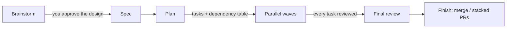
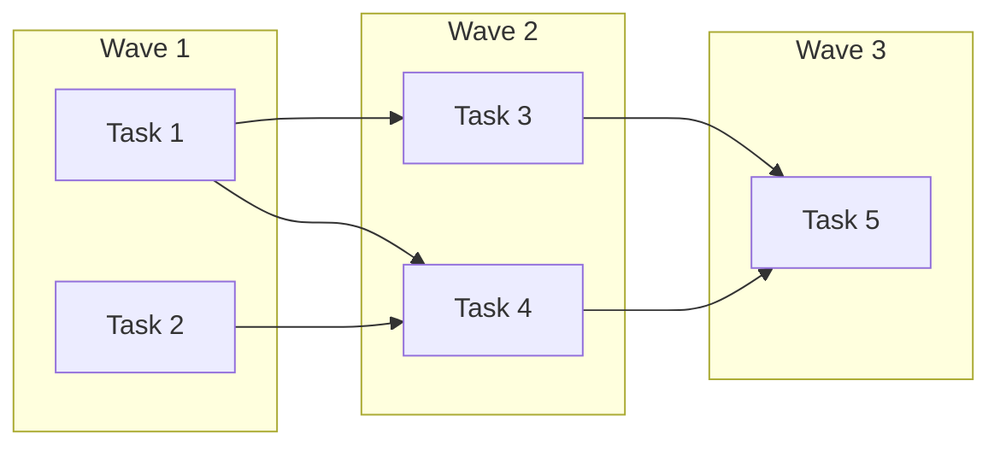
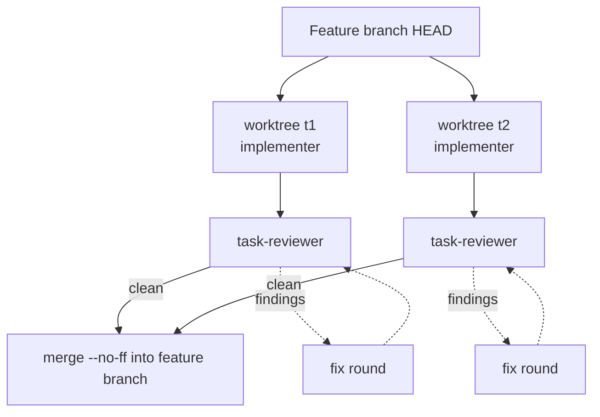

# Superagent

**An opinionated software development workflow for [OpenCode](https://opencode.ai),
run by a team of specialist subagents that execute your plan in parallel waves.**

Most coding agents start writing code when you finish typing. Superagent
doesn't. It makes your agent work like a disciplined engineering team: pin
down what you actually want, write a plan, then hand the plan to a crew of
fresh, narrowly scoped subagents. Independent tasks run at the same time, each
in its own git worktree, and every task is reviewed before it merges. The
main agent acts as a scheduler: it plans, dispatches, reviews and
reconciles, and it does not implement anything itself.

The skills trigger automatically. You don't call commands or remember a
process. You describe what you want and Superagent runs the workflow.

## Table of Contents

- [The workflow](#the-workflow)
- [Subagent-driven parallel wave execution](#subagent-driven-parallel-wave-execution)
- [The agent team](#the-agent-team)
- [Guardrails](#guardrails)
- [Watching it work](#watching-it-work)
- [Installation](#installation)
- [Configuration](#configuration)
- [What's inside](#whats-inside)
- [Philosophy](#philosophy)
- [How Superagent differs from Superpowers](#how-superagent-differs-from-superpowers)
- [Contributing](#contributing)
- [Updating](#updating)
- [Community](#community)
- [License](#license)

## The workflow

Superagent has strong opinions about how software gets built, and it enforces
them. The stages below are **mandatory workflows, not suggestions**. Before
any task, the agent checks which skill applies and follows it.



1. **Brainstorm first. No code before approval.** `brainstorming` has a hard
   gate: no code, no scaffolding and no implementation skill until you have
   approved a design. It starts by classifying the request out loud as a
   *spike*, *bounded* or *architectural*, so the ceremony fits the job:
   - **Spike**: a feasibility question. You get a short pitch, then an
     answer. Nothing it builds is kept.
   - **Bounded**: a small change to an existing flow. You get a short design
     in chat, and it waits for your yes.
   - **Architectural**: new projects and subsystems. Clarifying questions,
     alternatives, a design shown in sections you can actually read, then a
     written spec.

   When it's unsure, it takes the heavier path. Complexity found halfway
   through moves the task up a path. Nothing moves down.

2. **Plan for someone with no context.** `writing-plans` turns the spec into
   bite-sized tasks, each with exact file paths, complete code and
   verification steps. The bar is that an enthusiastic junior engineer with
   no project context and an aversion to testing could follow it. Every plan
   also carries a **Task Order & Dependencies** table: which agent does each
   task, what it depends on, and which files it shares. That table is what
   lets execution run in parallel.

3. **Execute with subagents in parallel waves.** `subagent-driven-development`
   computes waves from the dependency table and dispatches each wave's tasks
   at once. Every task has its own implementer, worktree and branch, and its
   own review. See [below](#subagent-driven-parallel-wave-execution).

4. **TDD, always.** `test-driven-development` enforces RED-GREEN-REFACTOR:
   write a failing test, watch it fail, write the minimal code, watch it
   pass, commit. Code written before its test gets deleted.

5. **Review everything.** Each task's diff is checked for spec compliance
   and code quality before it merges. When the plan is done, the whole
   branch gets a broad review on the most capable model available.

6. **Verify before claiming done.** `verification-before-completion` requires
   evidence such as test output or a command run before anything is reported
   as finished.

7. **Finish cleanly.** `finishing-a-development-branch` verifies the tests,
   then offers merge, PR, keep or discard, and cleans up the worktrees.
   Dependent work ships by default as a **stack of small PRs**, one per
   layer, through `using-stacked-prs`.

Once you say "go", the agent keeps going. It doesn't stop between tasks to
ask "should I continue?". It makes rulings when it hits ambiguity, records
each one with its reasoning, and continues. It stops for only four things:
destructive operations, security-sensitive actions, side effects outside the
worktree (merges, pushes, publishes), and a plan so broken that every way
forward is a guess. Running autonomously for hours without drifting from the
plan is normal.

## Subagent-driven parallel wave execution

This is the core of Superagent. A plan is executed as a sequence of
**waves**: sets of tasks that don't depend on each other and can safely run
at the same time.

### From plan to waves

The plan's dependency table defines the waves:

| Task | Agent | Depends on | Parallel with |
|---|---|---|---|
| 1 — Data model | implementer | — | 2 |
| 2 — Config loader | implementer | — | 1 |
| 3 — API handlers | implementer | 1 | 4 |
| 4 — CLI command | implementer | 1, 2 | 3 |
| 5 — Integration tests | implementer | 3, 4 | — |

Wave 1 holds the tasks with no dependencies. Wave *k+1* holds the tasks whose
dependencies all sit in waves 1 to *k*:



Before a wave starts, the controller checks that no two of its tasks touch
the same file (the **one-writer-per-file rule**). An overlap counts as a plan
defect. The controller serializes the pair or merges them into one task,
records the ruling, and continues. It never lets two tasks race on one file.

### How a wave runs



- **One worktree and branch per task.** Each task gets
  `.worktrees/<plan>/t<N>` on branch `<plan>/t<N>`, forked from the feature
  branch after its dependency waves have merged. That way a downstream task
  always sees the interfaces it consumes. No wave implementer touches the
  main checkout.
- **Background dispatch.** Every member of a wave is dispatched in a single
  message with OpenCode 2's `subagent` tool and `background: true`. The
  controller processes each report as it arrives instead of waiting for the
  slowest task.
- **Fresh context per task.** Each implementer gets a generated task brief,
  the interfaces it needs from earlier tasks, and a report-file contract.
  It does not get the session's history or the whole plan, so it stays
  focused and keeps the controller's context free for coordination.
- **Exact review ranges.** A task's branch contains only that task's
  commits, so its review package is exactly `base..<plan>/t<N>`. Every
  reviewer sees one task's diff and nothing else.
- **Bounded fix loops.** When a review finds problems, fix rounds 1–3 resume
  the same implementer in its worktree. Rounds 4–5 bring in a fresh
  implementer on a stronger model. After round 5 a circuit breaker trips:
  the controller adjudicates the remaining findings and records a ruling on
  each, so a stuck task can't loop forever.
- **Merge only when clean.** A task merges back with `--no-ff` only after its
  review passes. Because the files are disjoint, the merge is clean. A merge
  conflict means the plan's claim of disjoint files was wrong, and it is
  surfaced loudly as a plan defect instead of a silent overwrite.
- **Waves become stacked PRs.** Tasks within a wave are siblings and merge
  into one layer. Between dependent waves, each wave's merged result becomes
  its own stack layer, so a three-wave plan finishes as three small,
  independently reviewable PRs instead of one large one.

### Why it's worth it

Run serially, a plan takes as long as all its tasks added together. A wave
of *k* tasks takes roughly as long as its slowest task, plus a small
per-task cost for worktree setup, review and merge. Most implementation time
is spent waiting on model turns, so on any plan with real independence in
it, parallel waves are a large speed-up. You don't trade away review
quality, isolation or traceability to get it.

When parallelism isn't possible, the same loop runs serially. That happens
when there's no dependency table, every wave has one task, or worktree
creation fails in a sandbox. The serial fallback is noted in the ledger.

## The agent team

Superagent registers a roster of specialist agents. Each one has a narrow
job and can be routed to its own model:

| Agent | Job | Model slot |
|---|---|---|
| `superagent` | Primary agent. Plans and delegates, never implements. | `orchestrator` |
| `implementer` | One scoped task from a plan | `implementer` |
| `implementer-deep` | A task an earlier implementer couldn't fix | `implementerDeep` |
| `task-reviewer` | One task's diff: spec compliance and quality | `reviewer` |
| `re-reviewer` | Whether a fix round addressed its findings | `reviewer` |
| `code-reviewer` | The whole-branch review before merge | `deepReviewer` |
| `spec-reviewer` | A spec, before planning starts | `docReviewer` |
| `plan-reviewer` | A plan, before implementation starts | `docReviewer` |
| `oracle` | Architecture calls and bugs that resisted a fix | `oracle` |
| `librarian` | External docs and API research | `librarian` |

**Per-role model routing** is the reason the roster exists. OpenCode's
`subagent` tool is told never to choose a model itself, so the reliable way
to run reviewers on a different model from implementers is to make them
different agents, each with its model pinned. With routing, cheap and fast
models handle routine work and strong models handle the judgment calls:

```json
{
  "agents": {
    "models": {
      "implementer":  "anthropic/claude-haiku-4-5",
      "reviewer":     "anthropic/claude-haiku-4-5",
      "deepReviewer": "anthropic/claude-opus-4-5",
      "oracle":       "anthropic/claude-opus-4-5"
    }
  }
}
```

Out of the box every slot inherits your session model, so you get role
separation and context isolation without cost control until you route
slots. Use any IDs from `opencode models`. See
[docs/superagent.md](docs/superagent.md#model-routing).

**The council** (optional): for decisions that are expensive to get wrong,
`/council <question>` asks several distinct models the same question in
parallel. It reports whether they were unanimous, a majority or split, and
lists every dissenting risk that no other member raised.

## Guardrails

Parallel agents fail in specific ways. Superagent puts structural defenses
against those failures in place, instead of relying on prompt wording a model
can drift from under pressure:

- **Permissions enforce roles.** Specialists have the `subagent` tool denied,
  so a worker can't spawn its own helpers or reviewers. Reviewers and
  advisors also have `edit` denied. The orchestrator can write only under
  `.superagent/`, so it can't quietly implement "just this one small change".
- **The job board catches file collisions.** Every dispatch declares a
  file-ownership claim
  (`<!-- superagent-ownership: write=src/api/**; read=src/** -->`). If a
  later dispatch's write claim overlaps a running one, it gets a conflict
  warning, so a silently lost write becomes a visible one. This is a second
  net behind the per-task worktrees. `/board` prints the board.
- **A ledger survives compaction.** Progress is written to a per-plan ledger
  file, not just kept in conversation memory. After compaction, the
  controller resumes from the ledger and `git log`. It doesn't re-dispatch
  work that's already done, which is the most expensive failure seen in
  real sessions.
- **Rulings are recorded.** Every judgment call made mid-plan is written down
  with what was decided, why, and what it costs if it's wrong, so you can
  audit and undo it later.

## Watching it work

The plugin adds a panel to OpenCode's TUI sidebar for the human at the
keyboard. It shows the plan's progress and current task, the main agent's
active skill and what it is doing, and one row per subagent with the tool
call it is making right now, the files it owns, any ownership conflict, and
what came back:

```text
 Plan ━━━━━━━─────────────────── 1/4
 2026-11-03-demo.md
 ▸ Task 2: Count files

 Main · subagent-driven-development
 ◓ subagent implementer         0:07

 Subagents ───────────────────── 2/2
 ◓ implementer · Task 2         0:07
 ├ shell npm test
 └ owns src/api/**
 ✓ implementer · Task 1         1:05
 └ DONE — 3 commits, tests pass

 Superagent v0.1.0  team · 10 agents
```

## Installation

Superagent is a plugin for [OpenCode](https://opencode.ai) 2. It uses the
[OpenCode 2 plugin format](https://opencode.ai/v2/docs/plugins/) and does not
load in OpenCode 1.

- Tell OpenCode:

  ```text
  Fetch and follow instructions from https://raw.githubusercontent.com/taylorelley/superagent/refs/heads/main/.opencode/INSTALL.md
  ```

- Or install it with OpenCode's plugin manager:

  ```bash
  opencode plugin add github:taylorelley/superagent
  ```

  which is the same as adding it to the `plugins` array in your
  `opencode.json` (global or project-level):

  ```json
  {
    "plugins": ["github:taylorelley/superagent"]
  }
  ```

- Verify by asking: "What can Superagent do?"

That one entry loads the skills, the agent roster and the TUI sidebar panel.
There is no separate `tui.json` entry in OpenCode 2. The full install,
usage and troubleshooting guide is [.opencode/INSTALL.md](.opencode/INSTALL.md).

## Configuration

Configuration lives in `~/.config/opencode/superagent.json` or
`<project>/.opencode/superagent.json`. Comments and trailing commas are
allowed.

| Preset | What it does |
|---|---|
| `team` | Default. Full roster, job board on. |
| `council` | `team` plus the council. |
| `solo` | Agent-team layer off. Skills and bootstrap only, which is the original single-agent Superpowers workflow. |

| Command | What it does |
|---|---|
| `/board` | Show the job board for this session |
| `/council <question>` | Ask several models and synthesize the answers |
| `/preset [name] [--persist]` | Show or switch the preset |
| `/update [install]` | Check for, or install, a Superagent update |

The full schema, per-agent permission overrides, troubleshooting, and notes
on how the plugin API behaves (checked against OpenCode's source) are in
[docs/superagent.md](docs/superagent.md).

## What's inside

### Skills library

**Workflow**
- **brainstorming**: Socratic design refinement with a hard approval gate
- **writing-plans**: Detailed plans with a Task Order & Dependencies table
- **subagent-driven-development**: Parallel wave execution with per-task review
- **executing-plans**: Inline batch execution with human checkpoints
- **dispatching-parallel-agents**: Concurrent subagent workflows for independent problems
- **using-git-worktrees**: Isolated workspaces, including per-task wave worktrees
- **using-stacked-prs**: A chain of small, reviewable PRs for dependent work
- **finishing-a-development-branch**: Merge/PR decision workflow and cleanup

**Quality**
- **test-driven-development**: RED-GREEN-REFACTOR (includes a testing anti-patterns reference)
- **requesting-code-review**: Pre-review checklist and reviewer dispatch
- **receiving-code-review**: Responding to feedback with rigor
- **verification-before-completion**: Evidence before claims

**Debugging**
- **systematic-debugging**: A 4-phase root-cause process (root-cause tracing, defense in depth, condition-based waiting)

**Meta**
- **writing-skills**: Create and pressure-test new skills
- **using-superagent**: Introduction to the skills system, injected at session start

### Plugin

- `.opencode/plugins/`: the server plugin entry point
- `.opencode/lib/`: roster, routing, job board, council, commands, TUI panel
- `.opencode/prompts/`: orchestrator, oracle and librarian prompts
- `.opencode/tui/`: the sidebar panel

Superagent has zero dependencies. The one optional extra is `gh-stack`, which
`using-stacked-prs` detects at runtime. Without it, a plain git and forge CLI
fallback does the same job.

## Philosophy

- **Process over improvisation**: a fixed workflow beats a clever agent
  winging it.
- **Design before code**: nothing gets built until you've approved what's
  being built.
- **Test-driven development**: write tests first, always.
- **Fresh context, narrow scope**: each subagent gets exactly what its task
  needs and nothing else.
- **Parallel where safe, serial where not**: independence is declared in the
  plan and checked before dispatch, never assumed.
- **Structure over instruction**: enforce rules with permissions and
  worktrees rather than by asking nicely in a prompt.
- **Evidence over claims**: verify before declaring success.

## How Superagent differs from Superpowers

Superagent began as [Superpowers](https://github.com/obra/superpowers) and made
two deliberate bets:

- **OpenCode only.** Upstream targets many coding agents. Superagent targets
  one, so the skills aren't bent toward the lowest common denominator, and
  plugin behavior can be checked against OpenCode's source instead of
  assumed. See
  [docs/superagent.md](docs/superagent.md#how-the-opencode-2-plugin-api-is-used).
- **An agent-team layer upstream doesn't have.** That means the specialist
  roster with per-role model routing, parallel waves in isolated worktrees,
  the job board's ownership checks, the council, and permission-enforced
  roles.

It's all opt-in. `{"preset": "solo"}` turns the team layer off and gives you
the original single-agent workflow.

Superagent also removed the brainstorming skill's telemetry beacon. The only
outbound request left is an update check against GitHub, once per server
start, and it sends nothing about you or your project. Turn it off with
`{"updateCheck": {"enabled": false}}`; see
[docs/superagent.md](docs/superagent.md#updates).

## Contributing

Read [AGENTS.md](AGENTS.md) and the
[PR template](.github/PULL_REQUEST_TEMPLATE.md) first.

1. Fork the repository
2. Create a branch for your work
3. Follow the `writing-skills` skill for creating and testing new and modified skills
4. Open a PR using the pull request template

Plugin tests live in `tests/` (see [docs/testing.md](docs/testing.md)).

## Updating

```bash
opencode plugin update github:taylorelley/superagent
opencode service restart
```

or `/update install` from inside a session. See
[.opencode/INSTALL.md](.opencode/INSTALL.md#updating).

## Community

Superagent is a fork of [Superpowers](https://github.com/obra/superpowers),
built by [Jesse Vincent](https://blog.fsck.com) and the folks at
[Prime Radiant](https://primeradiant.com), and is maintained separately from
upstream. The agent-roster, job-board and council concepts are adapted from
[oh-my-opencode-slim](https://github.com/alvinunreal/oh-my-opencode-slim) (MIT)
and reimplemented from scratch.

- **Issues with this fork**: https://github.com/taylorelley/superagent/issues
- **Upstream Superpowers**: https://github.com/obra/superpowers
- **Original announcement**: [Superpowers](https://blog.fsck.com/2025/10/09/superpowers/)

## License

MIT License. See the LICENSE file for details.
